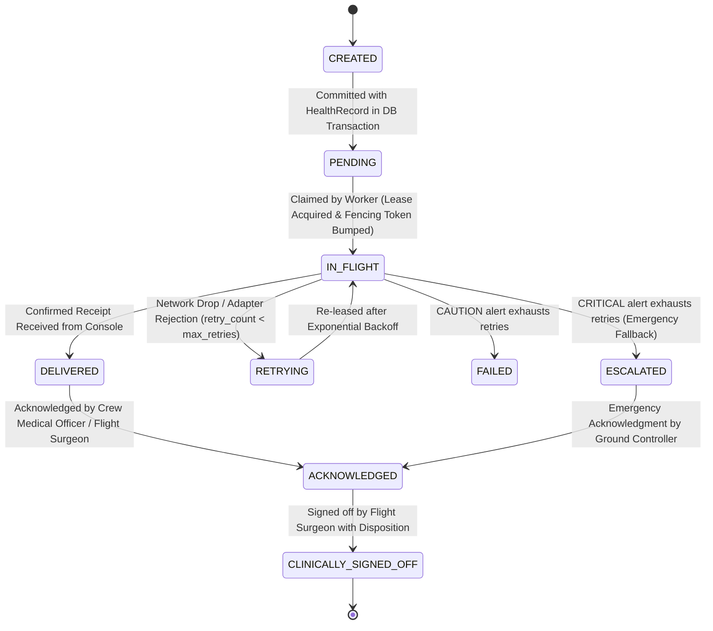

# Phase 11 — Alert Delivery Assurance, Receipt Validation & Fencing

## 1. Executive Summary
In life-support and astronaut operational environments, medical alert delivery must be guaranteed. A lost or unacknowledged critical alert can have catastrophic mission consequences. Phase 11 expands the Phase 10 Transactional Outbox pattern into an operational delivery assurance engine featuring:
1. **Confirmed Delivery Receipts**: No alert is marked `DELIVERED` without a cryptographically verified receipt payload.
2. **Optimistic Concurrency & Fencing Tokens**: Distributed recovery workers are prevented from double-dispatching or executing stale delivery writes via `lease_version` fencing tokens.
3. **Structured Attempt Logging**: Complete delivery telemetry history (`retry_history`) preserved per alert event.
4. **Emergency Escalation for Undelivered CRITICAL Alerts**: When a `CRITICAL` alert exhausts its retry budget ($N = 3$), it transitions to `ESCALATED` fail-safe state, initiating secondary emergency channels without suppressing or deleting the alert.

---

## 2. Nine-State Alert Event Lifecycle

The alert event lifecycle is formalized in `app/telemetry/schemas.py` and persisted in `app/models/alert_outbox.py`:



### State Definitions
- **`CREATED`**: Alert event instantiated in memory by the physiological rule engine.
- **`PENDING`**: Durably committed in `alert_outbox_events` alongside the vital reading.
- **`IN_FLIGHT`**: Leased by an active dispatch worker with a bounded lease timestamp (`locked_until`).
- **`DELIVERED`**: Adapter returned a valid delivery receipt matching `event_id`.
- **`RETRYING`**: Delivery failed; exponential backoff delay scheduled (`next_retry_at = now + 2^attempt`).
- **`RETRIED`**: Re-queued event actively reclaimed by a recovery worker.
- **`FAILED`**: Terminal state for non-critical (CAUTION) alerts that exhausted maximum retries.
- **`ESCALATED`**: Terminal fail-safe state for `CRITICAL` alerts that exhausted retries. Triggers audible flight room klaxon / ground emergency routing.
- **`ACKNOWLEDGED`**: Operational acknowledgment recorded by an authenticated user role.
- **`CLINICALLY_SIGNED_OFF`**: Medical review completed with documented clinical rationale and disposition.

---

## 3. Receipt Validation & Correlation
A delivery receipt payload must contain:
- `receipt_id`: Unique delivery confirmation identifier issued by the receiver console.
- `target_event_id`: Correlation ID matching the exact outbox `event_id`.
- `confirmed_at`: ISO-8601 UTC timestamp of reception.

```python
def validate_delivery_receipt(receipt: Any, expected_event_id: str) -> Dict[str, Any]:
    if not isinstance(receipt, dict):
        raise InvalidReceiptError("Receipt must be a dictionary")
    if not receipt.get("receipt_id"):
        raise InvalidReceiptError("Missing required 'receipt_id'")
    target_id = receipt.get("target_event_id")
    if target_id and target_id != expected_event_id:
        raise InvalidReceiptError(f"Receipt target_event_id mismatch: expected '{expected_event_id}', got '{target_id}'")
    return receipt
```

If a downstream adapter returns a corrupted receipt or a mismatched `target_event_id`, the delivery is rejected, the attempt is logged as failed, and the alert remains in outbox retry scheduling.

---

## 4. Fencing Tokens & Concurrency Protection
In a distributed deployment with multiple workers or during process restart recovery:
- Every time a worker claims an outbox record, `lease_version` is atomically incremented by +1.
- When the worker dispatches the alert, it submits its `expected_lease_version`.
- If a slow worker is delayed by garbage collection or network stall, and a recovery worker takes over and bumps `lease_version`, the slow worker's dispatch will fail with `StaleLeaseError`:
```
StaleLeaseError: Stale lease version 1 != current 2
```
This guarantees that **stale workers can never overwrite fresher recovery states** or corrupt delivery receipts.

---

## 5. Non-Suppression & Deterministic Safety Guarantee
Under no circumstances is an astronaut health alert silently dropped:
1. **Rule Evaluation Invariant**: When vital parameters violate critical physiological thresholds (e.g., $HR > 140\text{ bpm}$ or $SpO_2 \le 85\%$), the deterministic rule engine bypasses all statistical smoothing.
2. **Outbox Invariant**: Even if network connections to MCC completely fail, the outbox retains the record permanently.
3. **Escalation Invariant**: When $retry\_count \ge max\_retries$, CRITICAL alerts transition to `ESCALATED`, setting `is_escalated = True` and recording the escalation in the operational monitoring system.
