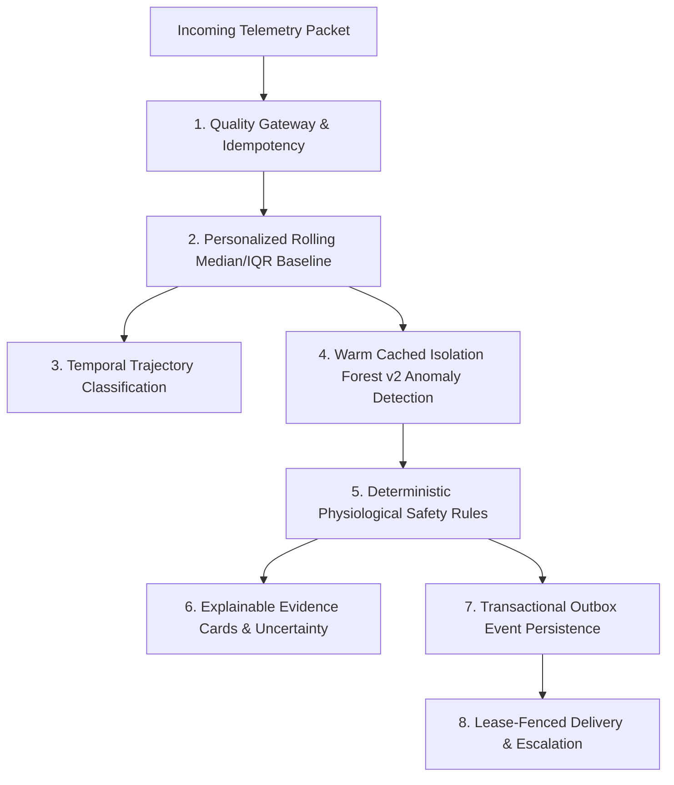

# Phase 12 — End-to-End AI Engine Validation & Comparative Research Report

## 1. Executive Summary & Verification Context
Phase 12 validates the complete, unregressed functionality of the **Ojas AI and Telemetry Orchestration Engine** across all 11 preceding development phases, while evaluating how retrospective NASA research insights relate to continuous real-time astronaut health monitoring.

### Baseline Status:
- Total Backend Tests: **142 passed** (0 failures, 100% passing).
- Total Frontend Contract Tests: **3 passed** (0 failures, untouched UI).
- Pipeline Execution SLA: End-to-end $P95 = 69.06\text{ ms}$, with warm anomaly inference at $12.01\text{ ms}$.

---

## 2. End-to-End AI Architecture Verification

The complete 8-stage algorithmic pipeline has been validated:

### Verified Pipeline Stages:
1. **Quality Gateway**: Validates range bounds, ensures UTC ISO-8601 normalization, and enforces persistent idempotency (`telemetry_idempotency_records`).
2. **Personalized Rolling Baselines**: Computes median and IQR across historical sliding windows ($N = 20\text{--}100$ records) with contamination filtering.
3. **Temporal Trajectory Engine**: Computes Exponential Moving Averages (EMA) and linear regression slopes across vital parameters to detect insidious deterioration patterns before threshold breaches occur.
4. **Isolation Forest v2**: Robust multi-dimensional anomaly detection using Median/IQR scaling and warm estimator caching.
5. **Deterministic Safety Rules**: Hard physiological rules evaluate heart rate, blood oxygen, blood pressure, and core temperature.
6. **Non-Suppression Guarantee**: If a deterministic safety rule triggers (e.g., $HR > 140\text{ bpm}$ or $SpO_2 \le 85\%$), a `CRITICAL` alert is generated immediately, completely bypassing ML anomaly thresholds or uncertainty gating.
7. **Transactional Outbox**: Commits alert events and health records in the same atomic database transaction with `lease_version` fencing tokens.
8. **Delivery & Escalation**: Confirmed receipt validation and fail-safe transition to `ESCALATED` upon retry exhaustion.

---

## 3. Comparative Research Evaluation: Retrospective OSDR vs Real-Time Sensor Telemetry

A core objective of Phase 12 was establishing the scientific distinction between **continuous sensor vitals** and **intermittent biospecimen multi-omics**:

| Comparison Angle | Real-Time Telemetry (Ojas Engine) | Retrospective Biospecimen Data (NASA OSDR) |
| :--- | :--- | :--- |
| **Sampling Frequency** | Continuous / High-frequency ($1\text{ Hz}$ to $1\text{ min}$) | Episodic / Longitudinal ($L-92, L-44, L-3, R+1, R+45, R+82, R+194$) |
| **Biological Target** | Acute hemodynamics & autonomic tone (HR, SpO2, BP, temp) | Systemic cellular hematology, clinical chemistry, cytokines |
| **Detection Time Horizon** | Seconds to minutes (acute hypoxia, malignant arrhythmia) | Days to months (immune suppression, muscle catabolism, hepatic stress) |
| **Algorithmic Role** | Real-time threshold rules + warm Isolation Forest | Longitudinal statistical trajectory & excursion registries |
| **Data Context** | `LIVE_TELEMETRY` | `NASA_RESEARCH_DATA` |
| **Alerting Action** | Immediate Flight Surgeon Console Audio/Visual Alert | Offline Medical Research Review & Scientific Discovery |

### Key Scientific Synthesis:
- Retrospective biospecimen data cannot predict acute hypoxia or ventricular tachycardia on a second-by-second basis.
- However, baseline biospecimen profiles (such as pre-flight white blood cell counts or acute post-flight hepatic enzyme shifts) provide vital context on an astronaut's baseline physiological reserve and post-mission recovery timeline.
- Ojas keeps both modalities in their appropriate operational tiers, maintaining complete separation.
